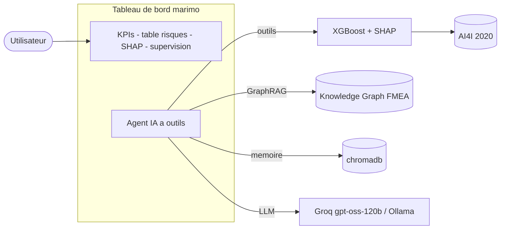

# 🔧 Assistant de maintenance prédictive — agent IA embarqué dans un notebook marimo

> Un tableau de bord **réactif (marimo)** où un **agent IA conversationnel** répond en langage
> naturel sur un modèle de risque de panne : il interroge le modèle **en direct** (SHAP, what-if),
> diagnostique les causes via un **knowledge graph**, garde une **mémoire** des diagnostics et
> surveille la **dérive des données**.

**Stack :** Python · marimo · XGBoost · SHAP · Pydantic AI (Groq / Ollama) · chromadb · NetworkX · MLflow · Docker · GitHub Actions

<!-- Ajoute ici une capture d'écran ou un GIF de démo :

-->

---

## 🎯 L'idée du projet

Le cœur de ce projet **n'est pas le modèle XGBoost** — il joue le rôle de **« moteur »**. Le vrai
sujet est de **transformer un modèle ML en produit réellement utilisable**,
en **greffant un agent IA directement dans le tableau de bord marimo**.

Au lieu d'un simple dashboard que l'utilisateur doit savoir lire, on peut **lui parler** :
*« Quels relevés sont à risque ? Pourquoi le relevé 7593 ? Que faire ? Y a-t-il une dérive des
données ? »* — et l'agent répond en **appelant les vrais outils** (modèle, SHAP, graphe de pannes,
monitoring), sans rien inventer.

**C'est ce couplage agent ⇄ notebook ⇄ modèle qui est la contribution du projet.**

---

## 🧰 Ce que le projet met en œuvre

Ce projet, de bout en bout :

- **IA agentique / LLM** : **agent à outils** (Pydantic AI), **GraphRAG** sur un knowledge
  graph de modes de panne, **mémoire** épisodique, **guardrails**, et **évaluation** (LLM-as-judge).
- **MLOps** : détection de **dérive** (PSI, Wasserstein, domain classifier, χ² sur `type`),
  réentraînement avec garde-fou **champion/challenger** (le challenger n'est promu que s'il **égale
  ou dépasse** le champion **rescoré sur le même jeu de test** ; chaque run journalisé), suivi
  **MLflow**, **Docker**, **CI** GitHub Actions (ruff + mypy + tests + build).
- **ML & explicabilité** : XGBoost sur données déséquilibrées, **SHAP** (global + local). Pour une
  machine donnée, le **risque, le SHAP et le what-if proviennent du même modèle hors-échantillon**
  (le modèle du fold qui ne l'a pas vue) — pas de contradiction entre ce qui est affiché et ce qui est expliqué.
- **Rigueur** : séparation train/serving, tests unitaires (**pytest** + couverture), **typage vérifié (mypy)** et lint/format (**ruff**) — le tout en CI.

**Résultats clés :** PR-AUC **0,87 ± 0,01** en validation croisée (0,90 sur le jeu de test,
**0,78** en découpage par ordre d'arrivée — plus réaliste) · ROC-AUC **0,98** · agent évalué sur
**31 questions catégorisées** (appels d'outils, exactitude des arguments, refus hors-sujet,
injections, groundedness) → `eval/report.md`.

---

## 🏭 Le problème 

En maintenance industrielle, on veut détecter les pannes au plus tôt pour intervenir *avant* la casse.
Ce projet, à partir de mesures machine (couple, vitesse, usure outil, températures) :

1. **estime** le risque de panne de chaque relevé (classification d'état — voir *Limites* pour la nuance « prédictif »),
2. **explique** pourquoi (variables en cause, mode de panne probable),
3. **recommande** des actions correctives **ancrées** dans une base de connaissances,
4. **surveille** que les données restent conformes à l'entraînement (dérive).

---

## ✨ Fonctionnalités

| | |
|---|---|
| 🤖 **Assistant IA** | agent conversationnel dans un panneau latéral, répond sur l'app, les machines, les causes et les actions |
| 📊 **Dashboard** | KPIs, table des relevés à risque (seuil réglable), importances SHAP globales, inspecteur SHAP par relevé |
| 🕸️ **Diagnostic** | knowledge graph des modes de panne (FMEA) → causes et actions **traçables** |
| 🩺 **Supervision** | simulation de dérive + rapport (PSI / Wasserstein / AUC) + bouton de réentraînement |

---

## 🧠 L'agent IA — techniques mises en œuvre

- **Agentique (agent à outils / tool-calling)** : l'agent raisonne en plusieurs étapes et appelle des
  outils Python (`predict_risk`, `explain_prediction`, `whatif`, `diagnose_mode`,
  `recommend_actions`, `check_drift`, …) → il **calcule** les réponses, il ne les invente pas.
- **LLM hybride** : même code pour **Groq** (`openai/gpt-oss-120b`, démo) ou **Ollama** (local, hors-ligne),
  via un client OpenAI-compatible routé par variable d'environnement.
- **Knowledge Graph + GraphRAG** : ontologie FMEA en NetworkX (modes → causes → symptômes →
  composants → actions → capteurs). Retrieval sémantique (**embedder multilingue**, FR) → sous-graphe
  étendu par voisinage → sérialisé **avec ses relations** (triplets `source --rel--> cible`), pas
  seulement du texte : la structure du graphe est réellement transmise au LLM. Le diagnostic par
  seuils reste **déterministe** (anti-hallucination).
- **Mémoire épisodique** : les diagnostics sont stockés **horodatés** (chromadb + embeddings),
  rappelés par **similarité** et **filtrables par machine** ; traités comme des notes utilisateur non vérifiées.
- **Guardrails & modèle de menace** : un pré-filtre **heuristique** écarte les injections les plus
  visibles, réglé pour **limiter les faux positifs** sur le vocabulaire métier (« montre-moi tes
  règles de seuil », « passe outre les consignes »…) — il n'est **pas exhaustif** et a des
  contournements connus (paraphrases, fautes de frappe). Le vrai rempart est **architectural** :
  tous les outils sont en **lecture seule** (seul `save_note` écrit, et son contenu est traité comme
  une note utilisateur non vérifiée) → une injection ne peut ni altérer le modèle/les données ni exfiltrer de secret.
- **Évaluation** (`eval/golden_set.yaml`, 31 questions par catégorie) : appels d'outils **et
  exactitude des arguments** (déterministe), **refus** des questions hors-sujet et des injections,
  gestion des **ID invalides**, et *groundedness* notée par un **LLM-as-judge distinct de l'agent**
  (qui reçoit les instructions de l'agent pour ne pas pénaliser les réponses légitimes). Le nombre
  de runs est réglable (`EVAL_RUNS`, 1 par défaut) ; **chaque métrique affiche son dénominateur**, et
  toutes — y compris les moins bonnes — sont publiées dans `eval/report.md`.

---

## 🏗️ Architecture



---

## 📊 Résultats

Modèle entraîné sur **AI4I 2020** : 10 000 **points de fonctionnement** (relevés de machines-outils,
pas 10 000 machines distinctes), **3,4 %** de pannes — fortement déséquilibré.

| Modèle | PR-AUC | ROC-AUC |
|---|---|---|
| Régression logistique (baseline) | 0,43 | 0,94 |
| **XGBoost** (Optuna + validation stratifiée) | **0,90** | **0,98** |

> La **PR-AUC** (métrique adaptée au déséquilibre) révèle l'écart réel entre les deux modèles,
> là où la ROC-AUC seule le masquerait. Facteurs les plus influents (SHAP) :
> `rotational_speed`, `tool_wear`, et la feature physique dérivée `power` — cohérents avec la physique des pannes.

**Robustesse du chiffre (tous générés par `python -m src.report_metrics`).** Le **0,90** est la
PR-AUC sur *un* découpage (jeu de test, 68 pannes) ; son **IC bootstrap à 95 % est [0,83 ; 0,96]** —
large, car les positifs sont rares. En validation croisée 5-fold : **0,87 ± 0,01**. En découpage par
**ordre d'arrivée** des relevés (proxy d'un déploiement temporel, 39 pannes en test) : **0,78**.
C'est ce dernier, le plus pessimiste, qui préfigure le mieux la production — un 0,90 isolé serait trompeur.

### Et une simple baseline par règles « métier » ? (où le ML aide, où il n'aide pas)

Les modes HDF, PWF et OSF d'AI4I 2020 sont **générés par des seuils documentés**. Une baseline FMEA
de trois règles codées à la main (`src/agent/knowledge_graph.py`) les retrouve donc presque parfaitement :

| Détection de panne | Précision | Rappel | Alertes |
|---|---|---|---|
| Règles FMEA fortes (HDF + PWF + OSF) | **1,00** | 0,85 | **287** |
| XGBoost (seuil par coût) | 0,66 | 0,86 | 447 |

Autrement dit, **sur ce dataset synthétique, trois règles font mieux que le ML** : à rappel quasi
identique (~0,85), elles ont une **meilleure précision** (1,00 vs 0,66) **et génèrent moins d'alertes**
(287 vs 447). C'est logique et il faut l'assumer — les labels sont fabriqués par ces seuils, le modèle
ne fait que les réapprendre.

**Alors pourquoi un modèle ?** Parce que l'objectif n'est pas de battre les règles sur AI4I, mais de
fournir ce qu'une règle binaire ne donne pas : un **score de risque calibré et classable** (0–100 %),
seul moyen de **prioriser**, et d'alimenter le seuil réglable, le SHAP, le what-if et l'agent. Le
modèle est le **moteur** ; la contribution du projet est la **chaîne produit** autour. *(Par mode :
les règles battent largement XGBoost sur TWF, 0,96 vs 0,22 ; les pannes aléatoires RNF sont
imprévisibles pour les deux, ~0 — plafond du dataset.)*

*(Tous les chiffres ci-dessus : `python -m src.report_metrics` → `models/report_metrics.json`.
Évaluation de l'agent : `eval/report.md`, via `python -m src.agent.eval`.)*

---

## 🗂️ Structure du dépôt

```
app.py                     tableau de bord marimo (dashboard + agent en sidebar)
src/
  config.py                chemins, graine, schéma des colonnes
  data.py                  téléchargement (UCI) + nettoyage + split
  features.py              feature engineering (features physiques) + pipeline
  model.py                 entraînement baseline + XGBoost (Optuna, MLflow)
  explain.py               SHAP (global + local)
  drift.py                 détection de dérive (PSI, Wasserstein, domain classifier)
  agent/
    llm.py                 LLM hybride (Groq / Ollama)
    tools.py               outils de l'agent (fonctions pures)
    agent.py               agent à outils (Pydantic AI)
    knowledge_graph.py     graphe FMEA + GraphRAG
    memory.py              mémoire épisodique (chromadb)
    guardrails.py          garde-fous d'entrée
    chat.py                pont vers mo.ui.chat
    eval.py                évaluation (tool-accuracy + LLM-as-judge)
knowledge/failure_modes.yaml   ontologie des modes de panne
models/                    artefacts entraînés (pipeline + métriques)
tests/                     tests unitaires (pytest)
Dockerfile, .github/workflows/ci.yml   conteneurisation + CI
```

---

## ▶️ Lancer en local

```bash
# 1. Environnement
python -m venv .venv
.venv/Scripts/activate            # Windows ;  source .venv/bin/activate sur Linux/Mac
pip install -r requirements.txt   # (ou requirements-dev.txt pour entraîner / tester)

# 2. Backend LLM — au choix :
#    a) Groq (clé gratuite sur console.groq.com) : créer un fichier .env
#         LLM_BACKEND=groq
#         GROQ_API_KEY=gsk_...
#    b) Ollama local (hors-ligne) : installer Ollama + `ollama pull qwen2.5:3b`, puis .env
#         LLM_BACKEND=ollama

# 3. Lancer l'application
marimo run app.py
```

Les artefacts du modèle (`models/`) et le jeu de données sont fournis : l'app démarre sans
étape d'entraînement. Le dashboard reste utilisable même sans clé LLM (seul l'agent est alors inactif).

**Autres commandes :**
```bash
python -m src.model          # réentraîner (Optuna + MLflow)
python -m src.agent.eval     # évaluer l'agent -> eval/report.md
pytest -q                    # tests
```

---

## 🚀 Déploiement

L'application est **conteneurisée** et **reproductible** : dépendances figées en closure transitive
(`requirements.lock`, via `pip-compile`), **Python épinglé** (3.12.2), et **embedder pré-téléchargé
dans l'image** → conteneur **autonome** (aucun téléchargement au premier appel, fonctionne hors-ligne).
La CI ne se contente pas de **construire** l'image : elle la **démarre et vérifie qu'elle sert le
dashboard** (smoke test). Non hébergée en continu (choix de gratuité), mais se lance en une commande :

```bash
docker build -t maintenance-agent .
docker run -p 7860:7860 --env-file .env maintenance-agent   # --env-file évite la clé dans l'historique shell
```

---

## ⚠️ Limites (en toute transparence)

- **Classification d'état, pas (encore) de prévision à horizon.** Le label `machine_failure` est
  **contemporain** des mesures : le modèle détecte un état de panne à partir des capteurs du même
  instant, il n'anticipe pas à N heures/cycles. Les 10 000 lignes sont des **relevés** (points de
  fonctionnement), pas 10 000 machines distinctes. Un vrai cas de maintenance *prédictive* demanderait
  des **séries temporelles par équipement** (p. ex. NASA C-MAPSS, estimation de RUL) — ce serait
  l'extension naturelle, en branchant la même chaîne agent dessus.
- **AI4I 2020** est un dataset **synthétique** (réaliste mais généré) ; il inclut des pannes
  purement **aléatoires** (RNF) qui plafonnent la performance atteignable.
- La **dérive est simulée** (dérive covariable sur un batch fabriqué) pour démontrer la chaîne de
  surveillance ; en production réelle, on brancherait le flux de données entrant à la place.
- Le réentraînement se fait sur les mêmes données : il illustre la **capacité opérationnelle**,
  pas une amélioration de performance.

---

## 📚 Données

[AI4I 2020 Predictive Maintenance Dataset](https://archive.ics.uci.edu/dataset/601/ai4i+2020+predictive+maintenance+dataset) — UCI Machine Learning Repository.
